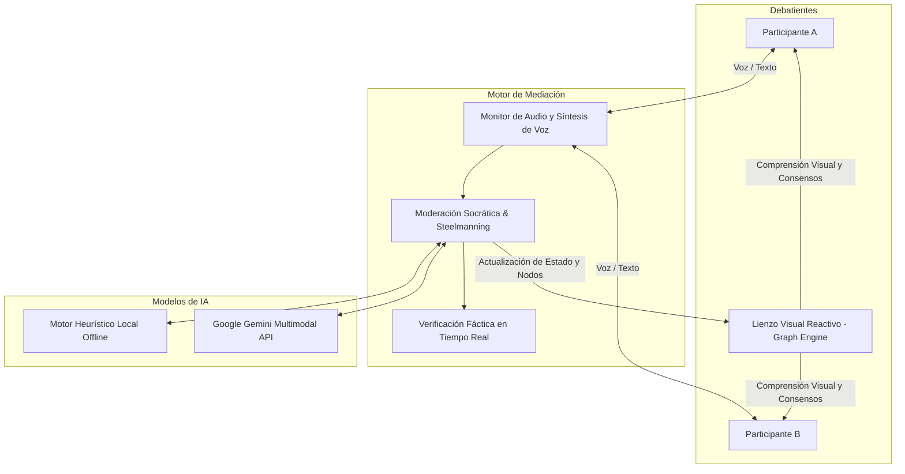

# AI Debate Mediator 🎙️🤝

[](https://majajicl.github.io/ai-debate-mediator/)
[](https://majajicl.github.io/ai-debate-mediator/)

Sistema interactivo e inteligente de mediación y facilitación de debates en tiempo real. Combina un **lienzo visual dinámico de argumentos (Argument Mapping)**, **moderación socrática constructiva (*steelmanning*)**, **verificación fáctica contextual en vivo** y **síntesis de voz**.

---

### 🌐 Demo en Vivo

Puedes probar la aplicación funcionando directamente en tu navegador aquí:
👉 **[https://majajicl.github.io/ai-debate-mediator/](https://majajicl.github.io/ai-debate-mediator/)**

---

## 🎯 ¿Qué problema resuelve?

En los debates humanos habituales, las conversaciones suelen estancarse en:
- Falsas dicotomías y polarización emocional.
- Discrepancias sobre hechos objetivos comprobables.
- Dificultad para recordar y consolidar los puntos en los que **ambas partes ya están de acuerdo**.

**AI Debate Mediator** actúa como un tercer participante neutral que no busca elegir un bando ganador, sino estructurar el diálogo hacia el entendimiento mutuo.

---

## ✨ Características Principales

1. **Lienzo Visual Reactivo (Physics-Based Graph Canvas)**:
   - Visualiza en tiempo real las posturas del Participante A (azul) y Participante B (ámbar).
   - Identifica y destaca los **nodos de consenso** (verde esmeralda con partículas animadas).
   - Delimita **puntos de divergencia** y clasifica la raíz del desacuerdo (valores, definiciones o datos).
   - Soporta arrastre de nodos, zoom y paneo fluido a 60 FPS.

2. **Moderación Socrática y *Steelmanning***:
   - Reformula cada argumento en su versión más lógica, empática y constructiva para desarmar la hostilidad.
   - Genera preguntas abiertas que invitan a descubrir salvaguardas mutuas.

3. **Verificación Fáctica en Segundo Plano (Fact-Checking)**:
   - Contrasta automáticamente afirmaciones empíricas y estadísticas con fuentes científicas y estudios de referencia (IPCC, FMI, NIST, etc.).

4. **Síntesis y Reconocimiento de Voz**:
   - Integración con Web Speech API para dictar argumentos con micrófono en español.
   - Voz de la IA mediadora que interviene con tono neutro y pausado.
   - Monitor visual de audio y ondas de voz en tiempo real.

5. **Modos de Operación**:
   - **Escenarios Predefinidos**: Casos guiados paso a paso (IA y Empleo, Transición Energética, Privacidad vs Seguridad).
   - **Debate Libre en Vivo**: Permite a dos usuarios debatir sobre cualquier tópico por texto o micrófono.
   - **Compatibilidad con Google Gemini**: Permite añadir una API Key de Gemini en configuración para inferencia avanzada en vivo, o funcionar con el motor heurístico local sin configuración previa.

6. **Acta y Reporte de Entendimiento Común**:
   - Exporta el balance de la sesión en Markdown o vista imprimible con porcentajes de consenso y acuerdos consolidados.

---

## 🏗️ Arquitectura del Sistema



---

## 💻 Ejecución Local

Si deseas correrlo localmente sin conexión:
1. Clona el repositorio:
   ```bash
   git clone https://github.com/MajajiCL/ai-debate-mediator.git
   cd ai-debate-mediator
   ```
2. Abre `index.html` en cualquier navegador web moderno (Chrome, Edge, Firefox, Safari).

---

## 📄 Licencia

Este proyecto está bajo la Licencia MIT.
