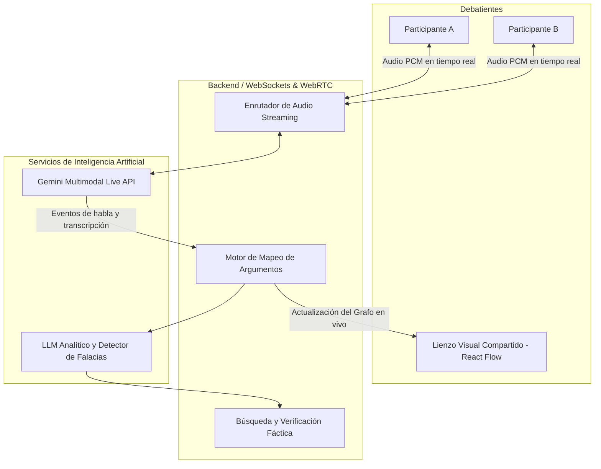

# AI Debate Mediator 🎙️🤝

Sistema inteligente de mediación y facilitación de debates en tiempo real. Combina análisis multimodal de voz de baja latencia con un lienzo interactivo que mapea consensos, divergencias y verificación fáctica automática para guiar a las personas hacia un entendimiento común.

---

## 🎯 Visión del Proyecto

El objetivo de **AI Debate Mediator** no es declarar un "ganador" en una discusión, sino transformar un enfrentamiento de posturas en una conversación constructiva. A través de tecnología conversacional y razonamiento socrático, la plataforma:

1. **Escucha y modera con empatía**: Aplica técnicas de *steelmanning* para reformular posturas en su forma más sólida.
2. **Visualiza el terreno común**: Traduce el debate verbal en un mapa conceptual interactivo de acuerdos y desacuerdos.
3. **Verifica hechos al instante**: Proporciona contexto fáctico en tiempo real para evitar desacuerdos basados en datos erróneos.

---

## 🏗️ Arquitectura del Sistema

---

## 🚀 Tecnologías Clave

- **Voz y Streaming Multimodal**: [Gemini Multimodal Live API](https://ai.google.dev/) sobre WebSockets / WebRTC.
- **Frontend & Canvas**: React, Next.js, Tailwind CSS, [React Flow](https://reactflow.dev/).
- **Backend & Orquestación**: Node.js / FastAPI con soporte para eventos en tiempo real.
- **Verificación Fáctica**: Integración RAG con APIs de búsqueda en tiempo real.

---

## 🗺️ Hoja de Ruta

- [x] Configuración inicial del repositorio y arquitectura técnica.
- [ ] Prototipo del lienzo visual de argumentos (React Flow).
- [ ] Integración del servidor WebSockets para sincronización de estados.
- [ ] Conexión con Gemini Multimodal Live API para audio bidireccional y moderación socrática.
- [ ] Motor de verificación contextual en segundo plano.

---

## 📄 Licencia

MIT
